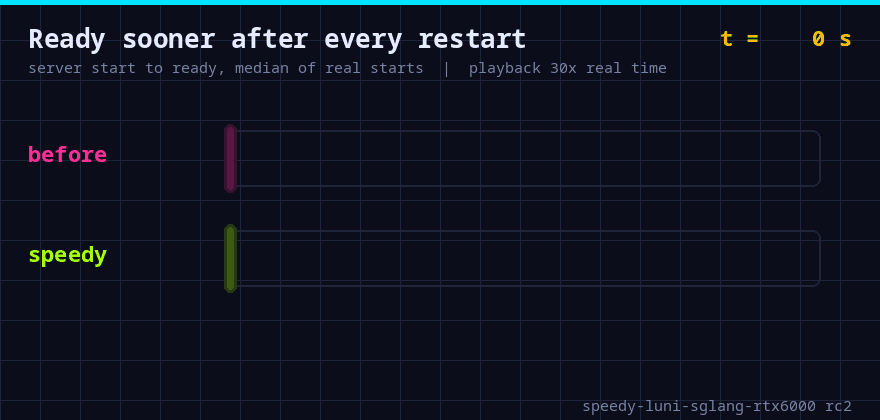
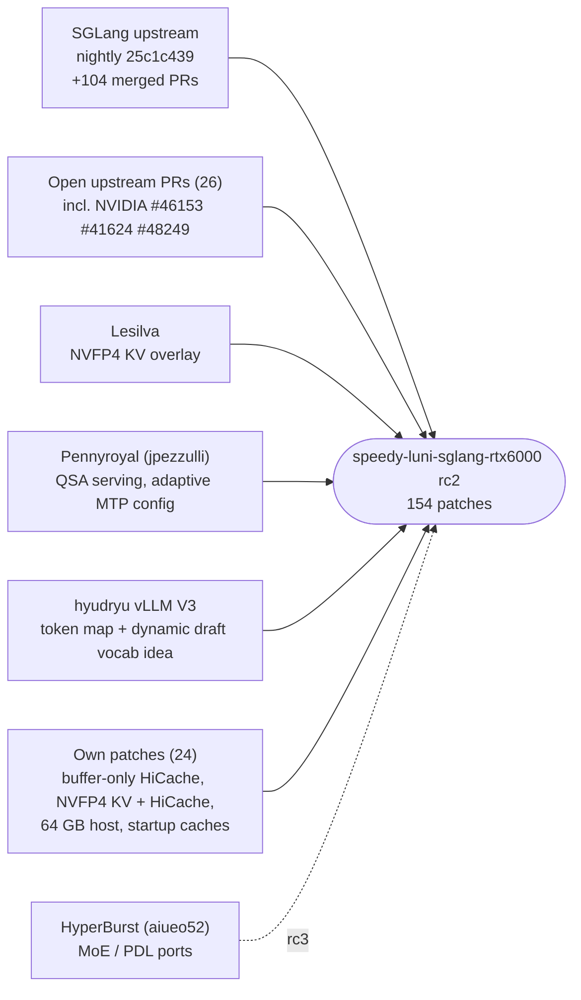

# speedy-luni-sglang-rtx6000

**Full SGLang speed for Qwen3.8 Flash-Next on a 64 GB laptop with an RTX PRO 6000 eGPU, without compromises.**

speedy is a **multi-source fork**: it starts from upstream SGLang and takes the best patches of every
Qwen3.8 Flash-Next fork (Lesilva, Pennyroyal, hyudryu's vLLM V3, NVIDIA's open PRs), plus its own.

<p align="center">
  
</p>

## Contents
- [Why speedy](#why-speedy)
- [Where it comes from](#where-it-comes-from)
- [Proof](#proof)
- [Quick start](#quick-start)
- [Repository layout](#repository-layout)
- [Credits and license](#credits-and-license)

## Why speedy

| | |
|---|---|
| **NVIDIA's official checkpoint** | [`nvidia/Qwen3.8-Flash-Next-FP4-Local`](https://huggingface.co/nvidia/Qwen3.8-Flash-Next-FP4-Local); stock SGLang needs three open NVIDIA PRs for it |
| **Runs on a 64 GB host** | 34.8 GiB host RAM for the whole server: packed NVFP4 PLE pinned at 26.8 GiB instead of 47.7 GiB |
| **Buffer-only HiCache on NVMe (saves a lot of host RAM!)** | no RAM cache tier: a 4 GB transfer buffer feeds a 200 GB NVMe prefix cache; others keep 32 GB HiCache in RAM |
| **NVFP4 KV together with HiCache** | 1M-token KV pool; FP4 block scales travel with every cached page |
| **Self-learning draft vocabulary** | the idea from hyudryu's vLLM V3, ported to SGLang: 48K static map + 8K ring of your agents' latest tokens |
| **Ready in 281 s** | instead of 359 s (−22 %): kernel, JIT and autotune caches survive restarts |

Tested host: **Lenovo ThinkPad L15 Gen 2**, i5-1145G7 (4 cores), **64 GB RAM**, RTX PRO 6000 Blackwell 96 GB
in a Razer Core X V2 **over USB4**. No workstation, no 256 GB server.

<p align="center">
  <br>
  
</p>

## Where it comes from



Every patch is numbered (`QFN-NNNN`) with origin, upstream PR, tests and status in
[docs/PATCHES.md](docs/PATCHES.md). Third-party authors are kept in Git.

## Proof

- **30 h of real agent production:** 33,588 requests, 2.11B prompt tokens, 94.7 % from the prefix cache.
- **Half a million tokens back in 1.3 s:** 422K–502K-token prompts take 34–38 s cold, 1.2–1.4 s cached.
- **Decode:** 210 tok/s at 1 stream, 618 tok/s at 8 streams.
- **Prefill:** 13.0K–13.7K tok/s on 8K–64K chunks. Under agent load most prefills are short suffixes
  (< 2K tokens) and run at about 8K tok/s; that is the next optimisation target.

<p align="center">
  <br>
  <br>
  
</p>

Full numbers, comparison and known limitations: [docs/releases/speedy-rc2.md](docs/releases/speedy-rc2.md).

## Quick start

```bash
git clone -b speedy-rc2 https://github.com/thomasdenk79-cyber/sglang speedy-src
git clone https://github.com/thomasdenk79-cyber/speedy-luni-sglang-rtx6000
cd speedy-luni-sglang-rtx6000
export SRC_DIR=$PWD/../speedy-src MODEL_DIR=/path/to/Qwen3.8-Flash-Next-FP4 CACHE_DIR=/path/to/cache
DRY_RUN=1 ./examples/run-rc2-production.sh   # print the command
./examples/run-rc2-production.sh
```

The stock SGLang nightly image runs the speedy source tree bind-mounted; there is no image build.

## Repository layout

| Path | Content |
|---|---|
| `docs/releases/` | release notes |
| `docs/PATCHES.md`, `patches/register.yaml` | patch register (generated by `scripts/patch_register.py`) |
| `examples/run-rc2-production.sh` | exact production launcher |
| `configs/`, `tokenmaps/` | adaptive MTP config, static draft token map |
| `docs/assets/`, `scripts/make_release_gifs.py` | release GIFs and their generator |

Engine source: [`thomasdenk79-cyber/sglang` @ `speedy-rc2`](https://github.com/thomasdenk79-cyber/sglang/tree/speedy-rc2).

## Credits and license

Apache-2.0. speedy builds on [SGLang](https://github.com/sgl-project/sglang),
[Lesilva's NVFP4 KV overlay](https://github.com/Lesilva/qwen38-flashnext-nvfp4-kv),
[Pennyroyal](https://github.com/jpezzulli/sglang-rtxpro6000),
[hyudryu's vLLM V3](https://github.com/hyudryu/Qwen3.8-Flash-Next-FP4-1xRTXPro6000) (MIT token map),
NVIDIA's SGLang pull requests and [HyperBurst](https://github.com/aiueo52/sglang-rtxpro6000).
Details in [NOTICE](NOTICE). Model weights are not distributed.
