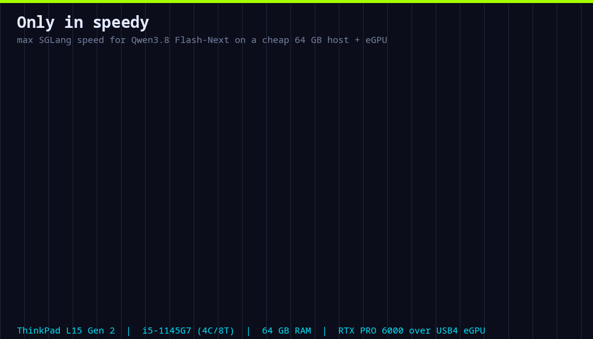
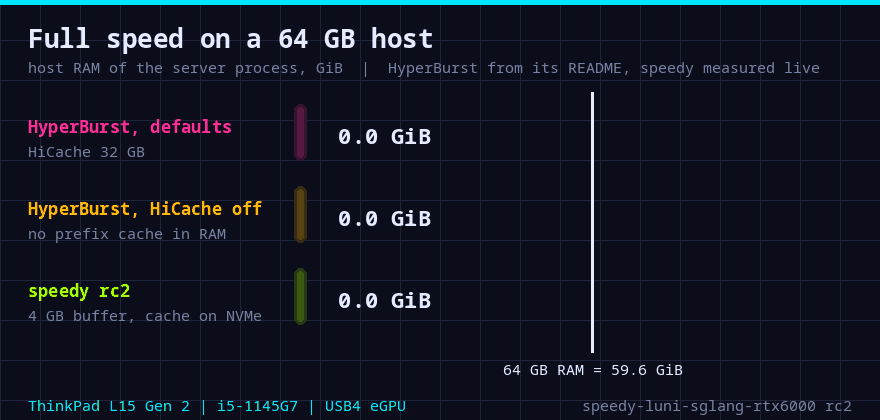
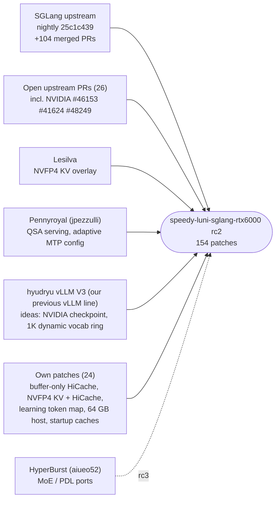
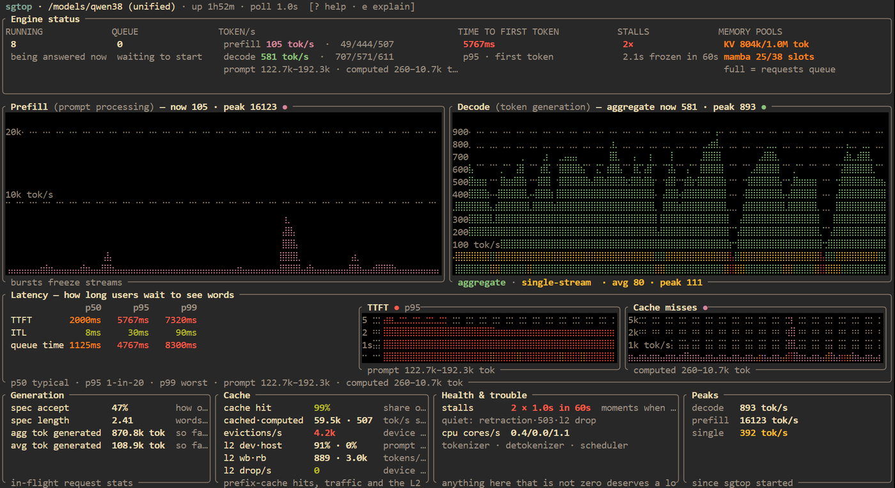
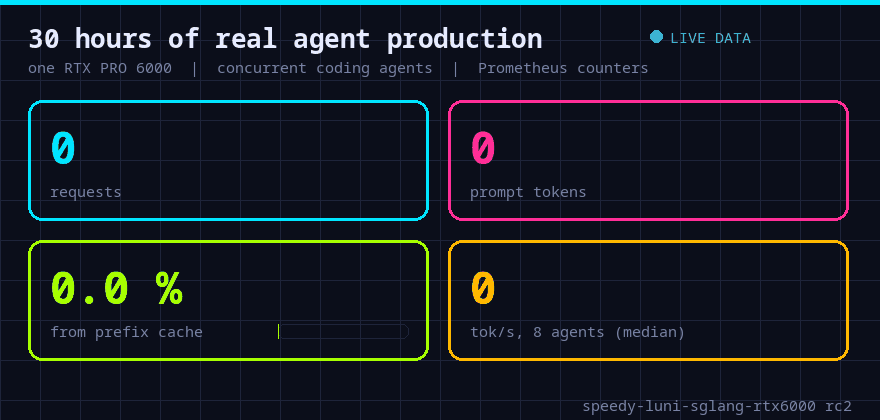
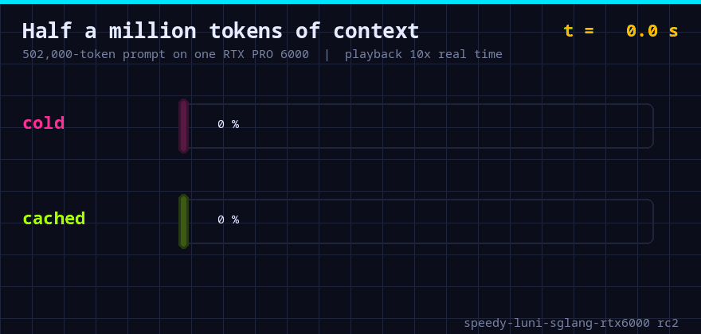
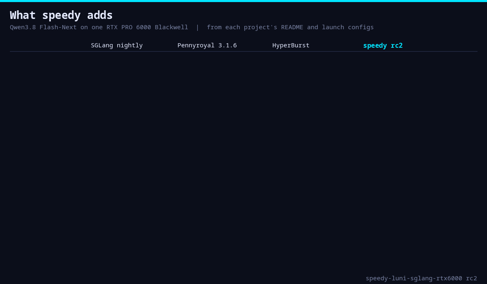

# speedy-luni-sglang-rtx6000

**Full SGLang speed for Qwen3.8 Flash-Next on a 64 GB laptop with an RTX PRO 6000 eGPU, without compromises.**

speedy is a **multi-source fork**: it starts from upstream SGLang and takes the best patches of every
Qwen3.8 Flash-Next fork (Lesilva's NVFP4 KV, Pennyroyal, ideas from hyudryu's vLLM V3, NVIDIA's open PRs),
plus its own.

<p align="center">
  
</p>

## Contents
- [Why speedy](#why-speedy)
- [Where it comes from](#where-it-comes-from)
- [Proof](#proof)
- [Quick start](#quick-start)
- [Repository layout](#repository-layout)
- [Credits and license](#credits-and-license)

## Why speedy

| | |
|---|---|
| **NVIDIA's official checkpoint** | [`nvidia/Qwen3.8-Flash-Next-FP4-Local`](https://huggingface.co/nvidia/Qwen3.8-Flash-Next-FP4-Local); stock SGLang needs three open NVIDIA PRs for it |
| **Runs on a 64 GB host** | 34.8 GiB host RAM for the whole server: packed NVFP4 PLE pinned at 26.8 GiB instead of 47.7 GiB |
| **Buffer-only HiCache on NVMe (saves a lot of host RAM!)** | no RAM cache tier: a 4 GB transfer buffer feeds a 200 GB NVMe prefix cache; others keep 32 GB HiCache in RAM |
| **NVFP4 KV together with HiCache** | 1M-token KV pool; FP4 block scales travel with every cached page |
| **Self-learning draft vocabulary** | hyudryu's vLLM V3 had a 1K fifo ring; speedy learns: 8K slots, last-used/LFU/tiered cache, persists across restarts. Draft misses 5.27 % → 0.19 % |
| **Faster loading: ready in 281 s** | instead of 359 s (−22 %): JIT kernels and autotune survive restarts, autotune 52 s → 4 s, NVMe prefix cache stays on disk ([details](#faster-loading)) |

Tested host: **Lenovo ThinkPad L15 Gen 2**, i5-1145G7 (4 cores), **64 GB RAM**, RTX PRO 6000 Blackwell 96 GB
in a Razer Core X V2 **over USB4**. No workstation, no 256 GB server.

<p align="center">
  <br>
  
</p>

## Faster loading

A restart costs agents minutes. speedy removes the work that stock SGLang repeats on every container
recreate (medians of 6 and 5 real production starts on the tested host):

| Step | Stock behaviour | speedy | Patch |
|---|---|---|---|
| **Startup to ready** | 359 s | **281 s (−78 s, −22 %)** | all below |
| FlashInfer autotune | profiles again on every start, 52 s | **replays the tactic cache, 4 s** | QFN-0146 `SGLANG_STARTUP_AUTOTUNE_REPLAY=1` |
| JIT kernels (~22), torch extensions, CuTe DSL | rebuilt on every container recreate | **kept under `SGLANG_CACHE_DIR`** | QFN-0145 |
| PLE table in host RAM | 47.7 GiB | **26.8 GiB packed NVFP4, pinned at exact size** | QFN-0093…0096 |
| CSF scale decode (73,728 stream pairs) | 17.9–21.3 s torch dispatch | numpy decode, ~3× faster per pair in a microbenchmark | QFN-0147 `SGLANG_STARTUP_CSF_FAST_DECODE=1` |
| NVMe prefix cache | – | 200 GB of files stay on disk across restarts | buffer-only HiCache |

Honest notes: the 78 s come from the persistent caches; the CSF fast decode shows no measurable gain in
the real startup logs yet. Reuse of the NVMe cache after a restart is not measured yet. The very first
start still JIT-compiles for several minutes; keep `CACHE_DIR` on a persistent disk.
HyperBurst documents ~47 min for its first build.

## Where it comes from



Every patch is numbered (`QFN-NNNN`) with origin, upstream PR, tests and status in
[docs/PATCHES.md](docs/PATCHES.md). Third-party authors are kept in Git.

## Proof

- **30 h of real agent production:** 35,720 requests, 2.31B prompt tokens, 94.9 % from the prefix cache,
  GPU busy 85 % of the time.
- **Half a million tokens back in 1.3 s:** 422K–502K-token prompts take 34–38 s cold, 1.2–1.4 s cached.
- **Prefill:** 13.0K–13.7K tok/s on 8K–64K chunks. Under agent load most prefills are short suffixes
  (< 2K tokens) and run at about 8K tok/s; that is the next optimisation target.

## Benchmarks: lab vs real agent load

Aggregate decode tok/s by concurrent requests (`scripts/real_load_stats.py`). **Lab:** BetterBench 0.6.0, short prompts, 48 requests
per level. **Real:** Prometheus, 30 h of coding agents ending 2026-11-19 06:05 CET, prompts of
**122K–192K tokens**, MTP acceptance length 2.75 (median), 15-s samples grouped by running requests.

| Streams | Lab | Real median | Real p90 | Real peak | Real per stream | Share of busy time |
|---:|---:|---:|---:|---:|---:|---:|
| 1 | 210 | 188 | 347 | 568 | 188 | 27 % |
| 2 | 346 | 352 | 458 | 706 | 176 | 19 % |
| 3 | – | 446 | 568 | 728 | 149 | 12 % |
| 4 | 489 | 509 | 644 | 781 | 127 | 8 % |
| 5 | – | 571 | 681 | 801 | 114 | 6 % |
| 6 | – | 578 | 731 | 950 | 96 | 6 % |
| 7 | – | 579 | 810 | 1,068 | 83 | 10 % |
| 8 | 618 | **642** | 808 | 1,029 | 80 | 10 % |

- With 150K-token agent contexts, speedy holds the short-prompt lab numbers: 8 agents get 642 tok/s
  in the median, about 80 tok/s each; bursts reach 800–1,000 tok/s.
- Real latency over 30 h: TTFT p50 0.9 s, p95 9.4 s; inter-token latency p50 6 ms, p95 25 ms.
- Honest: p99 TTFT is 30 s. These are the HiCache reissue-cap and queue cases (tasks 166/167).

<p align="center">
  <br>
  <sub>Live view (sgtop) under 8 running agents: KV 804K/1.0M tokens, 99 % cache hit, prompts 123K–192K, decode peak 893 tok/s.</sub>
</p>

<p align="center">
  <br>
  <br>
  
</p>

Full numbers, comparison and known limitations: [docs/releases/speedy-rc2.md](docs/releases/speedy-rc2.md).

## Quick start

```bash
git clone -b speedy-rc2 https://github.com/thomasdenk79-cyber/sglang speedy-src
git clone https://github.com/thomasdenk79-cyber/speedy-luni-sglang-rtx6000
cd speedy-luni-sglang-rtx6000
export SRC_DIR=$PWD/../speedy-src MODEL_DIR=/path/to/Qwen3.8-Flash-Next-FP4 CACHE_DIR=/path/to/cache
DRY_RUN=1 ./examples/run-rc2-production.sh   # print the command
./examples/run-rc2-production.sh
```

The stock SGLang nightly image runs the speedy source tree bind-mounted; there is no image build.

## Repository layout

| Path | Content |
|---|---|
| `docs/releases/` | release notes |
| `docs/PATCHES.md`, `patches/register.yaml` | patch register (generated by `scripts/patch_register.py`) |
| `examples/run-rc2-production.sh` | exact production launcher |
| `configs/`, `tokenmaps/` | adaptive MTP config, static draft token map |
| `docs/assets/`, `scripts/make_release_gifs.py` | release GIFs and their generator |
| `scripts/real_load_stats.py` | real agent-load numbers from Prometheus (source of the "Real" tables) |

Engine source: [`thomasdenk79-cyber/sglang` @ `speedy-rc2`](https://github.com/thomasdenk79-cyber/sglang/tree/speedy-rc2).

## Credits and license

Apache-2.0. speedy builds on [SGLang](https://github.com/sgl-project/sglang),
[Lesilva's NVFP4 KV overlay](https://github.com/Lesilva/qwen38-flashnext-nvfp4-kv),
[Pennyroyal](https://github.com/jpezzulli/sglang-rtxpro6000),
[hyudryu's vLLM V3](https://github.com/hyudryu/Qwen3.8-Flash-Next-FP4-1xRTXPro6000) (MIT token map),
NVIDIA's SGLang pull requests and [HyperBurst](https://github.com/aiueo52/sglang-rtxpro6000).
Details in [NOTICE](NOTICE). Model weights are not distributed.
