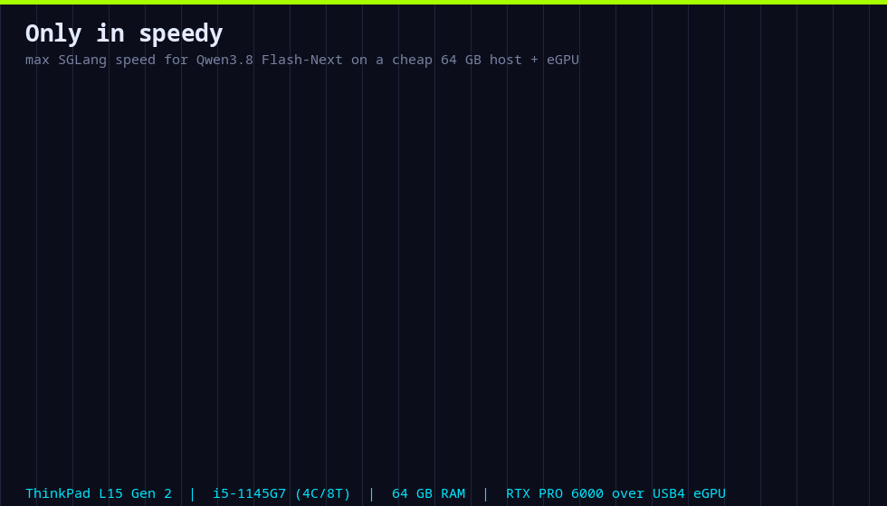
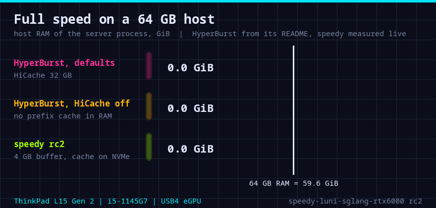
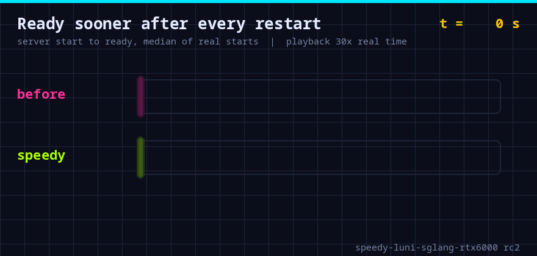
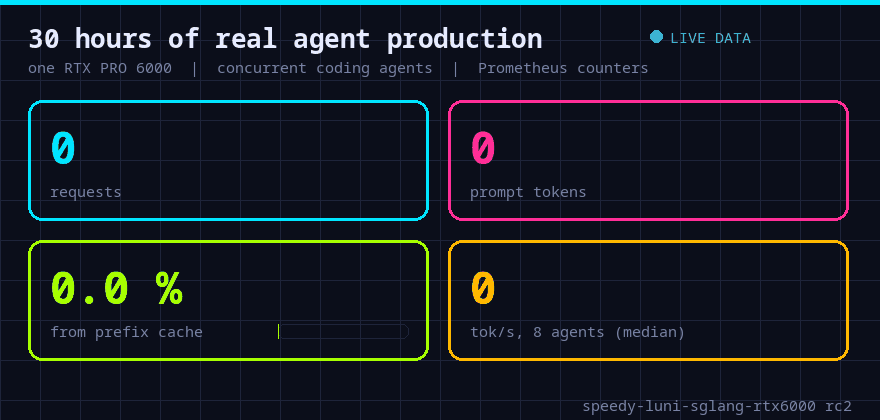
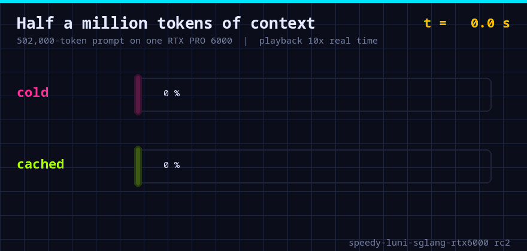
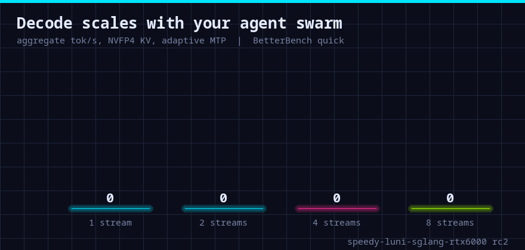
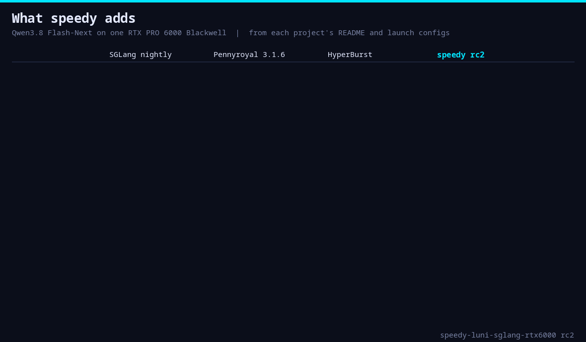

# speedy-luni-sglang-rtx6000 rc2: Qwen3.8 Flash-Next for coding-agent swarms on one RTX PRO 6000

**speedy-luni-sglang-rtx6000** ("speedy") is an SGLang build that serves **Qwen3.8 Flash-Next (NVFP4)** to many coding agents at
once on a **single RTX PRO 6000 Blackwell 96 GB**. It offers a 1M-token KV pool, 512K context,
adaptive MTP speculative decoding and a host-RAM + NVMe prefix cache. rc2 has been the production
engine of a multi-agent workstation since 2026-11-18.

- Engine source: [`thomasdenk79-cyber/sglang`, tag `speedy-rc2`](https://github.com/thomasdenk79-cyber/sglang/tree/speedy-rc2)
  (SGLang nightly `25c1c439` + 154 patches + 1 integration merge, head `1ad48f14e`)
- Configs, token map, launcher, patch register: [`thomasdenk79-cyber/speedy-luni-sglang-rtx6000`](https://github.com/thomasdenk79-cyber/speedy-luni-sglang-rtx6000) (this repository)
- Every patch with number, origin, tests and status: [docs/PATCHES.md](../PATCHES.md)

**A multi-source fork.** speedy is not a fork of one community build. It starts from **upstream SGLang**
and takes the best parts of every Qwen3.8 Flash-Next fork, plus own patches:

| Source | What speedy takes |
|---|---|
| [SGLang](https://github.com/sgl-project/sglang) nightly `25c1c439` | the engine, plus 104 merged upstream PRs backported |
| Open upstream PRs (26), including NVIDIA's [#46153](https://github.com/sgl-project/sglang/pull/46153), [#41624](https://github.com/sgl-project/sglang/pull/41624), [#48249](https://github.com/sgl-project/sglang/pull/48249) | official NVIDIA FP4-Local checkpoint, QSA fixes |
| [Lesilva NVFP4 KV overlay](https://github.com/Lesilva/qwen38-flashnext-nvfp4-kv) | NVFP4 KV cache for QSA (about -41 % KV memory) |
| [Pennyroyal](https://github.com/jpezzulli/sglang-rtxpro6000) by jpezzulli | QSA serving work and the adaptive MTP config |
| [HyperBurst](https://github.com/aiueo52/sglang-rtxpro6000) by aiueo52 | benchmark reference; draft MoE GEMV, MoE prune and PDL ports are queued for rc3 (QFN-0193…0208) |
| [hyudryu vLLM V3](https://github.com/hyudryu/Qwen3.8-Flash-Next-FP4-1xRTXPro6000), our previous vLLM line | two ideas: serve NVIDIA's official FP4-Local checkpoint, and a dynamic 1K-token draft-vocab ring; plus the 48K static token map (MIT) |
| **Own patches** (24 in rc2) | buffer-only HiCache with NVMe streaming, NVFP4 KV + HiCache, self-learning draft vocab, 64 GB host, startup caches |

## Why speedy

> **Full SGLang speed for Qwen3.8 Flash-Next on a 64 GB laptop with an eGPU, without compromises.**

<p align="center">
  
</p>

Most RTX PRO 6000 builds assume a workstation with 128–256 GB of RAM. speedy runs in production on
this host:

| | |
|---|---|
| Host | Lenovo ThinkPad L15 Gen 2, Intel Core i5-1145G7 (11th gen, 4 cores / 8 threads), **64 GB RAM** |
| GPU | NVIDIA RTX PRO 6000 Blackwell Workstation (96 GB) in a Razer Core X V2 **eGPU over USB4** (PCIe Gen4 x4) |
| Engine RAM | **34.8 GiB** for the whole server, under full agent load with HiCache on (cgroup `memory.current`) |

Six features that, as far as we know (2026-11-19), no other SGLang build for this model combines:

1. **NVIDIA's official checkpoint.** speedy serves
   [`nvidia/Qwen3.8-Flash-Next-FP4-Local`](https://huggingface.co/nvidia/Qwen3.8-Flash-Next-FP4-Local)
   (QAD-trained NVFP4, packed NVFP4 PLE). Stock SGLang needs three NVIDIA pull requests for it that are
   still open upstream ([#46153](https://github.com/sgl-project/sglang/pull/46153),
   [#41624](https://github.com/sgl-project/sglang/pull/41624),
   [#48249](https://github.com/sgl-project/sglang/pull/48249)); speedy carries them, plus a loader fix
   (QFN-0093…0096). [Pennyroyal](https://github.com/jpezzulli/sglang-rtxpro6000) and
   [HyperBurst](https://github.com/aiueo52/sglang-rtxpro6000) document community checkpoints
   (OrcaRouter, RadixArk). The idea to serve the NVIDIA checkpoint comes from hyudryu's vLLM V3 build;
   speedy brings it to SGLang.
2. **Runs on a 64 GB host.** The PLE table stays pinned in host RAM as packed NVFP4: **26.8 GiB** instead
   of 47.7 GiB for the FP8 table (HyperBurst README) or the 95.4 GiB BF16 table the stock loader would
   build. HyperBurst documents ~100 GiB of host RAM with its defaults, and 53.6 GiB only with HiCache
   switched off. Pennyroyal lists about 48 GiB for the RAM-backed PLE.
3. **Buffer-only HiCache: no RAM cache tier, the cache lives on NVMe (saves a lot of host RAM!).**
   Other builds keep a 32 GB HiCache **cache** in host RAM. speedy keeps none: host RAM holds only a
   **4 GB pinned transfer buffer** (`--hicache-host-memory-mode buffer_only`), and the prefix cache
   itself is a **200 GB file tier on NVMe**. Hits larger than the buffer stream through it in chunks
   (QFN-0142/0143), and reads go zero-copy into pinned memory (QFN-0154). Since the last restart,
   55 M tokens came back from NVMe instead of being recomputed.
4. **NVFP4 KV together with HiCache.** The NVFP4 KV overlay by [Lesilva](https://github.com/Lesilva/qwen38-flashnext-nvfp4-kv)
   saves ~41 % KV memory, but its code base refuses a HiCache host tier at startup: host pools copy only
   the K/V codes, so a restore would lose the FP4 block scales.
   speedy keeps the scales and the MTP draft KV in sidecars that travel with every page
   (QFN-0137…0140). The result is a 1M-token KV pool plus the NVMe cache.
5. **Self-learning draft vocabulary.** The starting point is the vLLM V3 build by
   [hyudryu](https://github.com/hyudryu/Qwen3.8-Flash-Next-FP4-1xRTXPro6000), our previous vLLM line: a
   48K static draft map plus a simple 1,024-slot first-in-first-out ring of prompt and output tokens.
   speedy turns this into a **learning token map** for SGLang (QFN-0099, QFN-0148):
   - **8x larger:** 8,192 dynamic slots on top of the 48K static map (identifiers, paths, project names).
   - **Smarter cache:** besides fifo, last-used (LRU), decayed-frequency (LFU) and tiered policies; tokens
     that keep getting accepted are promoted to a protected tier instead of being pushed out by the stream.
   - **Learns across restarts:** learned scores persist per profile, and a top-K map can be exported.
   - **No cost on the hot path:** in-place updates in fixed buffers, no host sync, CUDA graphs stay valid.

   CPU simulation on 2M-token code and prose workloads, 8 interleaved sessions: the static map alone
   misses 5.27 % of output tokens; an 8K ring cuts that to 0.22 % (fifo) and 0.19 % (LRU), and 0.11 % with
   a 24K LRU. Production runs 8K slots; the policy switch from fifo to LRU/tiered is opt-in.
6. **Faster restarts.** Ready in **281 s** instead of **359 s** (−22 %, medians of 6 and 5 real starts).
   Kernel, JIT and FlashInfer autotune caches survive container recreation, and autotune drops from
   52 s to 4 s (QFN-0145/0146).

<p align="center">
  <br>
  
</p>

## Highlights

<p align="center">
  <br>
  <br>
  <br>
  
</p>

> **One RTX PRO 6000. A whole agent swarm. 2.1 billion prompt tokens in 30 hours.**

- **Real agent production, not a lab benchmark:** 33,588 requests from concurrent coding agents in 30 h,
  2.11B prompt tokens, **94.7 % served from the prefix cache**.
- **Half a million tokens of context, back in 1.3 seconds:** 422K–502K-token prompts take 34–38 s cold
  and **1.2–1.4 s cached**, with identical output (needle test passed).
- **Ready in 281 s:** persistent kernel and autotune caches cut a restart by 78 s (−22 %).
- **Fast decode:** 210 tok/s at 1 stream, **618 tok/s at 8 streams** (NVFP4 KV); prefill 13.0K–13.7K tok/s
  for 8K–64K chunks (7.2K tok/s for 2K chunks, see limitations).
- **Every patch accounted for:** 214 numbered patches (`QFN-NNNN`) with origin, upstream PR, tests and
  status in [docs/PATCHES.md](../PATCHES.md).
- **Honest limits:** TTFT tail and HiCache load-back are open issues and documented below.

## Contents
- [Why speedy](#why-speedy)
- [Highlights](#highlights)
- [Compared with upstream, Pennyroyal and HyperBurst](#compared-with-upstream-pennyroyal-and-hyperburst)
- [What is different](#what-is-different)
- [Install](#install)
- [Benchmarks](#benchmarks)
- [Field test: 30 h of agent production](#field-test-30-h-of-agent-production)
- [Known limitations](#known-limitations)
- [Patch list](#patch-list)
- [Credits and licenses](#credits-and-licenses)

## Compared with upstream, Pennyroyal and HyperBurst

| | SGLang nightly | Pennyroyal 3.1.6 | HyperBurst (2026-11-12) | **speedy rc2** |
|---|---|---|---|---|
| Base | current nightly | SGLang 0.5.19 line | Pennyroyal + 121 patches | **nightly 2026-11-17 + 154 patches** |
| Built for | general serving | long chats, TP1/TP2 | single-stream decode | **concurrent coding agents** |
| Context | stock | 524K | 4 x 262K | **512K, 1M-token shared pool** |
| Concurrency | stock | 1-6 requests | up to 4 | **8 running** |
| Checkpoint | NVIDIA FP4-Local needs 3 open PRs | OrcaRouter / RadixArk NVFP4 | RadixArk NVFP4 | **NVIDIA FP4-Local (official, QAD)** |
| Host RAM (server) | stock | about 48 GiB for the PLE table alone | 100.5 GiB defaults, 53.6 GiB with HiCache off | **34.8 GiB with HiCache on (no RAM cache tier), runs on a 64 GB host** |
| KV cache | FP8 / BF16 | FP8 | FP8 | **NVFP4 (about -41 % KV memory), together with HiCache** |
| Host cache | HiCache | 32 GB HiCache RAM + NIXL disk | 32 GB HiCache RAM | **no RAM cache: 4 GB transfer buffer + 200 GB NVMe file tier, buffer streaming, zero-copy reads** |
| Drafting | NEXTN MTP | MTP + FR-Spec, DFlash2 (alpha) | MTP + NGRAM chain, OEA (hyperpro) | **adaptive tiered MTP, 48K static + 8K self-learning draft vocab** |
| Startup to ready | stock | not published | not published (first build ~47 min) | **281 s (359 s before, -22 %)** |
| Field proof | CI | releases, community results | benchmark harness | **30 h agent production, 2.1B prompt tokens** |
| Patch log | git | CHANGES.md, PROVENANCE.md | documented patch series | **214 numbered patches (QFN-NNNN) with origin and tests** |

Sources: each project's README and launch scripts (Pennyroyal 3.1.6, HyperBurst `launch/`), speedy from
`examples/run-rc2-production.sh`. HyperBurst is faster at one stream (BetterBench c=1 370 tok/s vs 210);
speedy trades single-stream speed for capacity: more sessions, longer prompts, NVFP4 KV.
Both build on Pennyroyal's work; please credit it first.

## What is different

| | Pennyroyal 3.1.x + NVFP4 KV overlay | speedy rc2 |
|---|---|---|
| Base | SGLang 0.5.19 integration branch | **current SGLang nightly** (2026-11-17) + 130 upstream PR backports |
| KV cache | FP8, or NVFP4 via overlay | **NVFP4 KV**, 1M-token pool |
| Context | up to 512K | 512K (YaRN override), one 1M pool shared by 8 running requests |
| Prefix cache | GPU radix | **Buffer-only HiCache**: 4 GB pinned transfer buffer (no RAM cache tier) + 200 GB NVMe file tier, buffer streaming, zero-copy, barrier-free file reads |
| MTP | NEXTN fixed or adaptive | NEXTN **adaptive tiered** (W8 at 1 stream, W4 at 2+), 7 steps, **48K static draft vocab + 8K dynamic ring** |
| Mamba/GDN state | | Mamba-slot admission and ping-pong lock fix, lazy extra-buffer radix strategy, rust radix core |
| Tuned for | benchmarks, single user | **concurrent coding agents** with 140K–500K-token prompts |

The 24 own patches (`OWN` in the register) target what agent swarms hit: long shared prefixes, many
concurrent sessions, Mamba-state pressure and host-memory traffic. 130 further patches are backports of
upstream SGLang pull requests (104 merged upstream, 26 still open upstream when backported); their
authors are kept in Git.

Upstream submission of the own patches is **deferred** until they have more field time
(`upstream: deferred` in the register).

## Install

Requirements:
- 1x RTX PRO 6000 Blackwell (SM120, 96 GB).
- NVIDIA driver with CDI (podman) or NVIDIA Container Toolkit (docker).
- **64 GB host RAM is enough** (the server uses ~35 GiB: 26.8 GiB pinned PLE, 4 GB HiCache transfer buffer, no RAM cache tier).
  Tested on a ThinkPad L15 Gen 2 (i5-1145G7) with the GPU in a USB4 eGPU enclosure.
- An NVMe with 200 GB free.
- A Qwen3.8 Flash-Next NVFP4 checkpoint (tested: `Qwen3.8-Flash-Next-FP4`, ModelOpt NVFP4).

There is no image build: the stock SGLang nightly image runs the speedy source tree bind-mounted to `/src`.

```bash
git clone -b speedy-rc2 https://github.com/thomasdenk79-cyber/sglang speedy-src
git clone https://github.com/thomasdenk79-cyber/speedy-luni-sglang-rtx6000
cd speedy-luni-sglang-rtx6000
podman pull docker.io/lmsysorg/sglang:nightly-dev-cu13-20261117-25c1c439

export SRC_DIR=$PWD/../speedy-src MODEL_DIR=/path/to/Qwen3.8-Flash-Next-FP4 CACHE_DIR=/path/to/cache
DRY_RUN=1 ./examples/run-rc2-production.sh   # print the command
./examples/run-rc2-production.sh

curl -s http://127.0.0.1:30000/health && curl -s http://127.0.0.1:30000/v1/models
```

- `examples/run-rc2-production.sh` reproduces the production server flags and environment exactly
  (checked against `podman inspect` of the running engine).
- For docker, set `CONTAINER_CLI=docker GPU_ARGS="--gpus all"`.
- The first start JIT-compiles kernels for several minutes; keep `CACHE_DIR` persistent.
- Tuning knobs: `MAX_RUNNING` (8), `MAX_TOTAL_TOKENS` (1000000), `CONTEXT_LENGTH` (524288), `HICACHE_MAX` (200G).
- Endpoints: OpenAI-compatible API on `:30000/v1`, Prometheus metrics on `/metrics`.

## Benchmarks

Setup: BetterBench 0.6.0, 1x RTX PRO 6000 (350 W cap), rc2, temperature 0.7, 48 requests per
concurrency level, 8 runs per prefill depth, 2026-11-18.

| Metric | rc2 NVFP4 KV (1M pool) | rc2 FP8 KV |
|---|---:|---:|
| Aggregate decode tok/s, 1 stream | 210 | 236 |
| Aggregate decode tok/s, 2 streams | 346 | 345 |
| Aggregate decode tok/s, 4 streams | 489 | 517 |
| Aggregate decode tok/s, 8 streams | 618 | 667 |
| Prefill 2K (median pp / TTFT) | 7,182 tok/s / 220 ms | 6,013 tok/s / 258 ms |
| Prefill 8K | 13,523 tok/s / 437 ms | 13,711 tok/s / 432 ms |
| Prefill 16K | 13,045 tok/s / 909 ms | 13,233 tok/s / 897 ms |
| Prefill 32K | 13,666 tok/s / 1,719 ms | 12,531 tok/s / 1,884 ms |
| Prefill 64K | 13,329 tok/s / 3,533 ms | 11,689 tok/s / 4,027 ms |

- NVFP4 KV costs 0–11 % decode throughput and is equal or faster on prefill.
- In return it provides the 1M-token pool that keeps the agents' 140K–500K-token prefixes resident.
- MTP acceptance length is 2.3–4.5 depending on the task (mean 3.27 over code, explanation, math and
  JSON prompts).

Long context: needle test, then the cache is flushed and the context restored.

| Prompt | Cold prefill | Cached follow-up turn | Needle | Restore after cache flush |
|---:|---:|---:|:---:|---:|
| 422K | 34.0–38.5 s | 1.2–1.4 s | pass | 29.9–30.6 s, output identical |
| 502K | 38.3 s | 1.4–1.5 s | pass | 37.3 s, output identical |

## Field test: 30 h of agent production

Source: Prometheus, engine `:30000`, 30-hour window ending 2026-11-19 05:00 CET.
Workload: OpenCode / oh-my-opencode coding agents, an autonomous task operator and a multi-agent
implement/test/review pipeline, all going through a LiteLLM gateway.

| | |
|---|---:|
| Requests | 33,588 |
| Prompt tokens | 2.11 B |
| Of which served from prefix cache | 2.00 B (**94.7 %**) |
| Generated tokens | 24.7 M |
| Peak aggregate decode | 1,728 tok/s |
| Running requests | up to 8, mean 1.2 over the window |
| TTFT p50 / p95 | 0.9 s / 9.2 s |
| Typical prompt | 139K–194K tokens, of which 0.2K–2.6K newly computed |
| Restarts | 1 planned (2026-11-19 01:35) |

## Known limitations

These are under active analysis; expect changes in rc3.
- **Prefill speed under agent load.** The 13.5K tok/s are measured on 8K+ chunks without load. In
  production 64 % of prefill batches are short suffixes below 2K tokens (the rest of the prompt comes from
  the prefix cache), with one request per batch, so real prefill runs at about 8K tok/s. Batching
  short suffixes and prefill CUDA graphs above 1K tokens are planned for rc3.
- **Prefill stalls.** Under full agent load, 8K-token prefill chunks pause all decode streams for about
  1 s, around 15 times per minute. `--prefill-decode-interval 1` is already set.
- **TTFT tail.** p95 is 9–10 s and p99 reaches up to 35 s, dominated by cache misses on 140K+ prefixes.
- **HiCache under load.** The NVMe tier works (55 M tokens restored since the last restart, output
  identical), but the 4 GB buffer is often busy with backups. In 5 h, 87 requests gave up on the NVMe
  copy after 8 retries and were recomputed, which costs up to ~30 s on a long prefix. The buffer stream
  only starts for hits larger than the empty buffer. rc3 adds stream-on-busy and larger file objects,
  both behind flags.
- **USB4 link.** On an eGPU (PCIe Gen4 x4, ~3 GB/s) HiCache load-back (2.0 GB/s) and write-through
  backups (2.7 GB/s) share the link with decode. A selective write policy is being evaluated.
- **Spec acceptance on long contexts.** The acceptance rate drops to about 0.6 (accept length 2.8) on long
  agent contexts.
- **Test coverage.** Tested only on one RTX PRO 6000 (SM120): no multi-GPU, no other checkpoints.

## Patch list

[docs/PATCHES.md](../PATCHES.md) is generated by `scripts/patch_register.py` (`--check` detects drift);
the machine-readable copy is `patches/register.yaml`.
- 214 numbered patches (`QFN-0001`…), one row each with origin, upstream PR, tests, env flags,
  GPU validation and status.
- **rc2 (this release): 154 patches** (24 OWN, 104 BACKPORT, 26 BACKPORT-UNMERGED).
- rc3 (15 OWN) and 45 pending patches are listed but not part of this release.
- Release asset `speedy-rc2-patches.tar.gz` contains the rc2 series (154 `git format-patch` files,
  linearised, tree-identical to `1ad48f14e`) against `25c1c439`. Apply with
  `git am --keep-cr --3way` (upstream has CRLF files); expected tree `d7884fcc`.

## Credits and licenses

speedy-luni-sglang-rtx6000 is released under Apache-2.0 and builds on:
- **SGLang** and the authors of every backported pull request (sgl-project/sglang, Apache-2.0).
- **Pennyroyal** by jpezzulli (jpezzulli/sglang-rtxpro6000, Apache-2.0): QSA serving stack and the
  adaptive MTP config `configs/adaptive-next-tiered.json` (unchanged).
- **Lesilva** ([Lesilva/qwen38-flashnext-nvfp4-kv](https://github.com/Lesilva/qwen38-flashnext-nvfp4-kv), Apache-2.0):
  the NVFP4 KV cache for QSA, ported from this overlay onto upstream SGLang. speedy extends it with
  HiCache support (FP4 block scales and MTP draft KV in sidecars).
- **NVIDIA** pull requests [#46153](https://github.com/sgl-project/sglang/pull/46153),
  [#41624](https://github.com/sgl-project/sglang/pull/41624) and
  [#48249](https://github.com/sgl-project/sglang/pull/48249) (still open upstream): the loader for the
  official `nvidia/Qwen3.8-Flash-Next-FP4-Local` checkpoint.
- **HyperBurst** by aiueo52 (aiueo52/sglang-rtxpro6000, Apache-2.0): benchmark reference; ports of its draft
  MoE GEMV, MoE prune and PDL work are queued for rc3 (QFN-0193…0208).
- **hyudryu** (hyudryu/Qwen3.8-Flash-Next-FP4-1xRTXPro6000, vLLM V3, MIT): the ideas to serve the NVIDIA
  FP4-Local checkpoint and to add a dynamic draft-vocabulary ring, and the 49,152-token draft
  vocabulary V3 in `tokenmaps/`; the MIT text is in `tokenmaps/hyudryu_LICENSE`.

Details are in [NOTICE](../../NOTICE). Model weights are not distributed.
